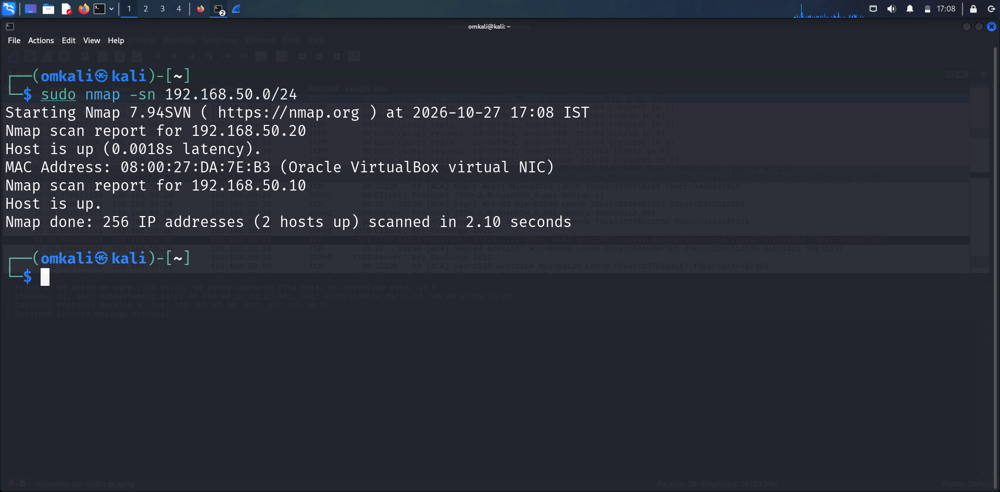
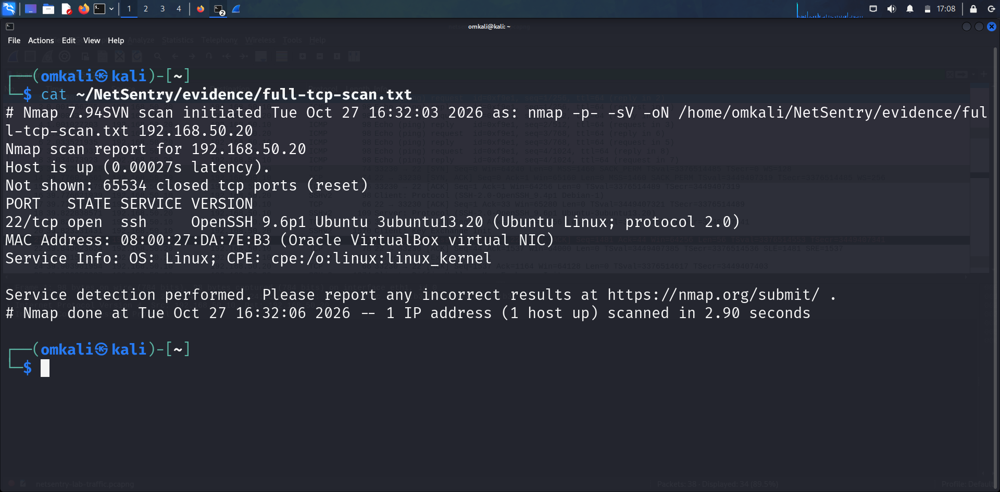
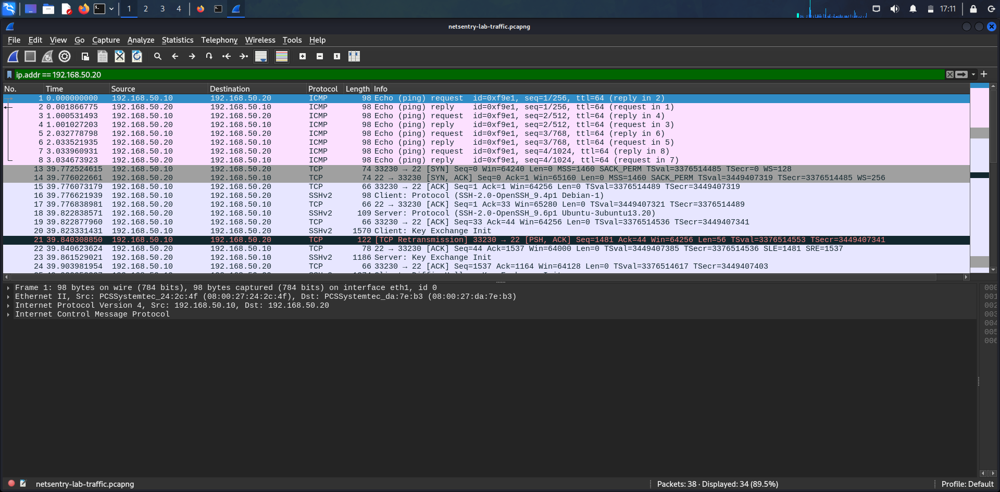
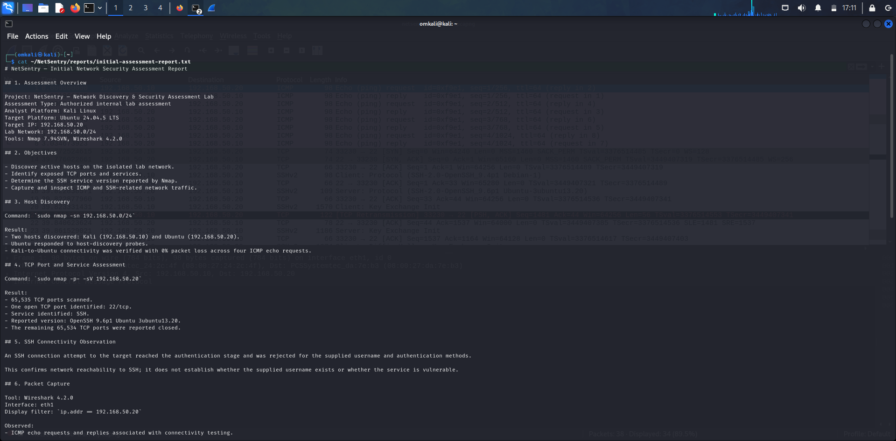
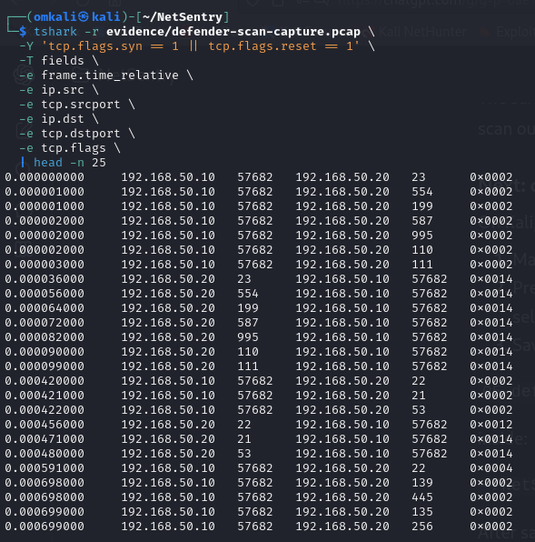

# NetSentry — Network Discovery & Security Assessment Lab

## Project Overview

NetSentry is a hands-on network discovery and security assessment project built using Kali Linux and Ubuntu virtual machines. I created this lab to practise identifying active hosts, checking TCP ports and services, capturing network traffic, and documenting security-related observations.

One of the main goals of the project is to understand how network scanning looks from both the scanner's and the target's perspective. By comparing Nmap results with packet captures and authentication logs collected on the Ubuntu machine, I explored how different sources of evidence help explain network activity.

The entire lab runs on an isolated VirtualBox internal network, allowing me to perform controlled security assessments in an environment I manage.

## Objectives

- Discover active hosts on a private lab subnet.
- Identify open and closed TCP ports.
- Perform service and version detection using Nmap.
- Capture and analyse network traffic using Wireshark and tcpdump.
- Compare remote scan results with packet-level evidence collected on the target.
- Review relevant service and authentication logs.
- Document findings, limitations, and practical security recommendations.

## Lab Setup

| Component | Configuration |
|---|---|
| Analyst machine | Kali Linux |
| Target machine | Ubuntu 24.04.5 LTS |
| Lab network | `192.168.50.0/24` |
| Kali lab IP | `192.168.50.10` |
| Ubuntu lab IP | `192.168.50.20` |
| Network isolation | VirtualBox Internal Network |
| Scanning tool | Nmap 7.94SVN |
| Packet analysis | Wireshark and tcpdump |
| Capture analysis | TShark |

Both virtual machines also have separate NAT adapters for internet connectivity. NetSentry assessment traffic is generated over the isolated internal network.

## Assessment Workflow

I followed a step-by-step workflow to keep the assessment organised and make the results easier to verify.

1. Set up isolated network connectivity between Kali and Ubuntu.
2. Discover active hosts on the lab subnet.
3. Scan all TCP ports on the target and identify exposed services.
4. Generate selected ICMP and SSH traffic for packet inspection.
5. Capture and analyse the resulting network traffic.
6. Run a controlled TCP SYN scan against ports 1–1000.
7. Capture the same scan from the Ubuntu target's perspective.
8. Compare Nmap findings with the packet-level responses.
9. Review SSH and authentication logs for relevant events.
10. Document the findings, supporting evidence, limitations, and recommendations.

## Repeatable Network Assessment

To make the basic network checks easier to repeat, I added a Bash script that checks target reachability, scans TCP ports 1–1000, and saves the results in a timestamped directory.

### Run the assessment

From the Kali VM, run:

```bash
./scripts/network_assessment.sh 192.168.50.20
```

The script accepts only valid host addresses within the isolated NetSentry lab subnet (`192.168.50.0/24`). It rejects malformed IP addresses, targets outside the permitted subnet, and the scanner's own IP address.

### Generated evidence

Each run creates a separate directory under `reports/runs/` containing:

- `assessment-summary.txt` — reachability results, scan output, and an evidence checksum.
- `tcp-scan.txt` — Nmap results for TCP ports 1–1000.

The script uses a TCP connect scan. A failed ping does not automatically stop the TCP scan because ICMP responses can be blocked even when TCP services are reachable.

### Run the tests

```bash
./tests/test_network_assessment.sh
```

The test suite checks Bash syntax and verifies that invalid IP addresses, out-of-scope targets, and the scanner's own IP address are rejected.

### Scope and limitations

This script provides a repeatable, limited TCP assessment rather than a complete vulnerability assessment. It does not scan UDP ports, confirm whether a service is vulnerable, or determine whether observed activity is malicious.

The results represent the target's state at the time of the scan and may differ if its configuration or network conditions change.

## Key Results

During the lab exercises, I was able to:

- Discover two active hosts on the lab subnet.
- Scan all 65,535 TCP ports on the Ubuntu target during the initial assessment.
- Identify SSH running on TCP port 22.
- Observe the reported service version: OpenSSH 9.6p1 Ubuntu 3ubuntu13.20.
- Find no other open TCP ports during the initial full-port scan.
- Capture ICMP and SSH-related traffic for further analysis.
- Capture a controlled TCP SYN scan from the target's perspective.
- Confirm that the defender-side capture showed SYN probes, SYN-ACK responses for TCP/22, and reset responses for closed ports.
- Compare network evidence with the SSH and authentication logs reviewed during the exercise.
- Produce initial assessment and defender-side analysis reports.

These results reflect the lab at the time of testing. They do not prove that the Ubuntu machine is free from vulnerabilities.

## Defender-Side Analysis

For this exercise, I used Kali (`192.168.50.10`) to scan the Ubuntu target (`192.168.50.20`) across TCP ports 1–1000. I then captured the corresponding traffic on the Ubuntu machine to compare what the scanner reported with what the target received and sent.

Nmap reported one open port, TCP/22, and 999 closed ports. The packet capture collected on Ubuntu independently showed the corresponding TCP probe and response patterns.

| Observation | What it tells us |
|---|---|
| TCP SYN probes from Kali | Consistent with the controlled Nmap SYN scan. |
| SYN-ACK from TCP/22 | Indicates that the SSH port was accepting TCP connection requests. |
| RST-ACK responses from closed ports | Indicates that the target rejected connection attempts on those ports. |
| Reset from Kali after the SYN-ACK | Consistent with SYN-scan behaviour rather than a completed TCP connection. |
| SSH authentication events | Failed and successful password-authentication events were recorded, but they cannot be conclusively attributed to the SYN scan. |

An important takeaway from this exercise is that packet captures and authentication logs show different parts of network activity. A packet capture can reveal connection probes and responses, while authentication logs can record attempts to authenticate to a service.

The reviewed logs contained SSH authentication events, but the available evidence did not establish that those events were caused by the recorded SYN scan.

Similarly, not finding a corresponding authentication event in the reviewed log output does not mean the activity was invisible to every host or network monitoring mechanism.

## Findings and Recommendations

### Finding 1: SSH is reachable on the lab interface

**Evidence:** Nmap scan results and the defender-side packet capture.

**Recommendation:** Keep SSH enabled only where needed and restrict access to trusted sources where practical.

### Finding 2: Closed ports returned TCP reset responses

**Evidence:** The packet capture collected on the Ubuntu target.

**Recommendation:** Compare remote scan results with local listening sockets and applicable firewall rules to understand which services are actually exposed.

### Finding 3: Network evidence and authentication logs provide different views

**Evidence:** TCP probes and responses were captured, while no corresponding SSH authentication event was observed in the reviewed logs.

**Recommendation:** Correlate network and host evidence when investigating scanning or connection activity. Review the relevant log sources and time ranges before drawing conclusions.

### Finding 4: The repeatable assessment identified one open TCP port in the scanned range

**Evidence:** The October 29, 2026 assessment of `192.168.50.20` reported TCP/22 open and 999 other TCP ports closed across ports 1–1000. The saved scan output and its SHA-256 checksum are available in the generated assessment report.

**Interpretation:** SSH was reachable during this assessment. These results do not establish whether the service is vulnerable, whether its configuration is secure, or what services may exist outside the scanned range.

**Recommendation:** Review the SSH configuration and access requirements on the Ubuntu target. If further assessment is needed, document the scope and compare the results before and after any controlled configuration change.

These findings come from controlled lab exercises. They are observations to investigate and learn from, not proof of malicious activity or a confirmed vulnerability.

## Repository Structure

```text
NetSentry/
├── evidence/
│   ├── full-tcp-scan.txt
│   ├── ssh-service-scan.txt
│   ├── netsentry-lab-traffic.pcapng
│   ├── defender-tcp-scan.txt
│   └── defender-scan-capture.pcap
├── reports/
│   ├── initial-assessment-report.txt
│   ├── defender-side-analysis.txt
│   ├── sample-run/
│   │   ├── assessment-summary.txt
│   │   └── tcp-scan.txt
│   └── runs/                  # Generated locally; ignored by Git
├── scripts/
│   └── network_assessment.sh
├── tests/
│   └── test_network_assessment.sh
├── screenshots/
│   ├── 01-host-discovery.png
│   ├── 02-full-tcp-scan.png
│   ├── 03-wireshark-traffic.png
│   ├── 04-assessment-report.png
│   └── 05-defender-side-analysis.png
├── .gitignore
└── README.md
```

## Tools and Technologies

- Kali Linux
- Ubuntu 24.04.5 LTS
- Oracle VirtualBox
- Nmap
- Wireshark
- TShark
- tcpdump
- Bash scripting
- Linux networking and command-line utilities

## Screenshots

The following screenshots document the main stages of the assessment and provide a visual reference for the results.

### 1. Network Host Discovery



### 2. Full TCP Port Scan



### 3. Wireshark Traffic Capture



### 4. Initial Assessment Report



### 5. Defender-Side Packet Analysis



## Limitations

While this project covers several practical network assessment tasks, there are some important limitations:

- The initial assessment covered TCP ports; UDP was not comprehensively assessed.
- The defender-side scan covered TCP ports 1–1000, not every possible port.
- Service version information does not, by itself, prove a vulnerability.
- A port scan cannot establish malicious intent on its own.
- Authentication-log observations are limited to the logs and time ranges reviewed.
- The lab does not implement a complete SIEM, alerting, or incident-response pipeline.

## Future Improvements

There are several areas I plan to explore to build on the current lab:

- Review the SSH configuration and document a controlled hardening change.
- Compare assessment results before and after the hardening change.
- Add a structured assessment report covering severity, evidence, impact, and remediation.
- Explore additional authorised network troubleshooting scenarios.
- Document the assessment script's failure-handling tests and their results.

